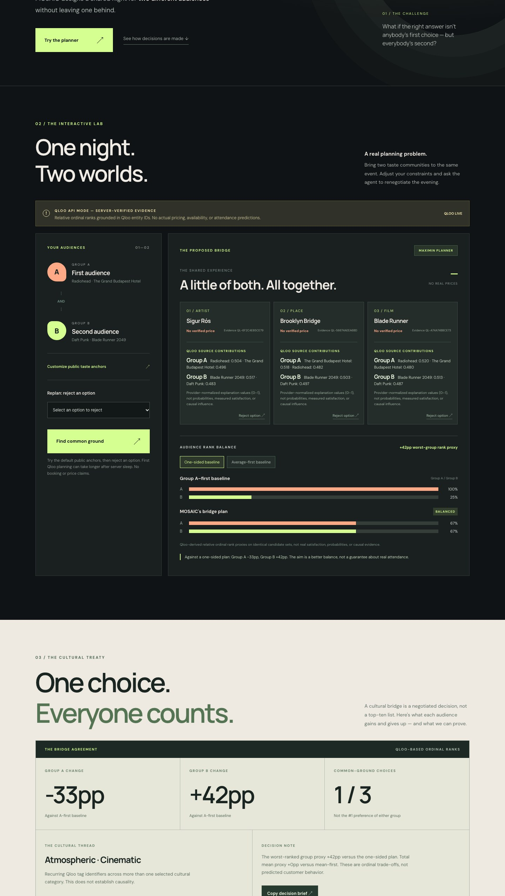

# MOSAIC — Common Ground, by Design

**A cultural negotiation agent for event promoters and community organizers.**

*One room. Two audiences. A cultural agreement that explains the trade-offs.*

[**Interactive preview — synthetic data**](https://abdullah-m7.github.io/qloo-mosaic/) · [**Live Qloo judge demo**](https://mosaic-agent-2026.onrender.com/) · [**Public release verification**](docs/JUDGE_RELEASE_GATE.md) · [**90-second judge walkthrough**](docs/JUDGE_DEMO_90S.md) · [**Devpost submission copy**](docs/DEVPOST_READY_COPY.md) · [**Full Devpost draft**](docs/DEVPOST_DRAFT.md) · [**Qloo Agentic Hackathon**](https://qloo.devpost.com/)



[View the 390px mobile judge walkthrough](docs/mosaic-live-judge-mobile.jpg). These screenshots were captured from the **public live Render deployment** after commit `8a7a297` was deployed and verified on 28 October 2026. This does not mean the Devpost entry has been submitted.

> **Live data status (October 28, 2026):** The public Render application is now serving evidence-backed Qloo plans. The anonymous `npm run judge:check` release probe passed against the live URL with three grounded categories, a verified provider-tag thread and cached veto renegotiation. The GitHub Pages preview remains intentionally **synthetic**. The technical release pass is not a Devpost submission confirmation.

## The challenge

An event promoter wants to bring together communities with different cultural tastes — for example, independent film fans and electronic music listeners. Choosing what the largest group prefers may alienate the other. Choosing whatever has the best average rank may still neglect one audience.

MOSAIC designs a *shared cultural activation* spanning an artist, a place and a film-themed experience. The key output is **the Cultural Bridge Agreement**: an explainable proposal showing which options provide common ground, how each community's relative rank changes compared with alternative selection policies, and what cultural connections can actually be traced to Qloo evidence.

It does **not** book venues, reserve artists, license films or predict a real audience's satisfaction.

## What the agent does

1. **Discover:** Ask Qloo for relevant entities using publicly chosen taste anchors from both groups. If joint discovery returns too little evidence, try a **single bounded alternative**, never an unbounded search.
2. **Compare:** Rank the *identical* shortlist against each group's taste anchors independently. Use **within-list ordinal percentile proxies** rather than treating scores from separate Qloo calls as directly comparable or calibrated probabilities.
3. **Negotiate:** Search feasible three-category combinations and maximize the **lower** of the two relative group rank scores. Show separate globally computed one-sided and average-first baselines, not a strawman comparator.
4. **Verify cultural threads:** Reuse the actual Qloo tag identifiers already attached to discovered entities. No additional tag-search API calls are required. A shared cross-category motif is shown **only if Qloo reports the same verified tag across two selected categories**. Otherwise the UI explicitly states *No cross-domain thread verified*.
5. **Adapt and explain:** Reject options, change the taste anchors and inspect the tool trace. The planner reuses cached Qloo evidence for ordinary veto-based renegotiation; incomplete or ambiguous Qloo evidence causes abstention, **never a synthetic fallback disguised as Qloo**.
6. **Stress-test the agreement:** Automatically remove each chosen category once and recompute the best feasible alternative using the **same** verified candidate rankings. Reveal how much the lower audience rank proxy would change or explicitly report no alternative. No extra Qloo calls, invented availability, or real-world robustness claims.
7. **Expose the negotiation frontier:** Enumerate the exact Pareto-efficient group-rank trade-offs over the same grounded shortlist. A no-network dial lets people preview alternative agreements and compare the official maximin choice with an explicitly limited rank-blind alphabetical policy. The blind comparison still uses Qloo entity discovery, and optimization's in-sample advantage is **not** empirical human uplift.
8. **Explain contributions directly from Qloo:** Where the event API returns documented `query.explainability`, the live cards show which public artist/movie anchors Qloo marked as contributors for each audience. An absent provider explanation remains explicitly absent; normalized contribution values are not satisfaction probabilities or causal claims.
9. **Find a verifiable cultural thread, not a generated story:** Use exact Qloo provider tag IDs shared across two different candidate categories to discover an alternative cultural agreement. Search all shortlisted combinations within a maximum **five-percentage-point** loss in the lowest audience's ordinal rank proxy; show which alternative was selected and precisely how much balance was traded off, or abstain if Qloo has no shared evidence. Zero additional Qloo requests.

Unlike a conventional group recommender, the application exposes the cultural and decision-making process: whose preference shaped the result, how the compromise changes, and which cultural links are — or are not — supported.

## First-look demo

In the **synthetic preview**, choose a planning budget, inspect three candidate experiences, switch the one-sided versus mean-first comparison, veto a suggestion and watch the agreement update. Click *Copy decision brief* to capture the chosen items, evidence identifiers, quantified trade-off and limitations.

The preview's example scores, tag availability and planning tokens are invented **solely for demonstration and testing**. The GitHub Pages link is a synthetic-only illustration. The separately hosted Render Node application is the live Qloo-backed judge experience; neither demo contains an API key in browser code.

## What is implemented, versus what is not

| Area | Verified status |
| --- | --- |
| Responsive interface, working veto/undo and comparison controls | Tested in desktop and mobile Chrome |
| Optimizer, provenance gates, bounded agent orchestration and cultural treaty | **127/127 baseline checks; 131/131 checks on the subsequently deployed 28 Oct release candidate**; offline tests mock Qloo, plus a separate real public API release probe |
| Deterministic algorithmic falsification | 500 **synthetic** scenarios, 429 feasible; see below |
| Public open-source repo and externally hosted Node app | **Live Qloo mode verified publicly on Render (28 Oct)**; static GitHub Pages remains synthetic |
| Qloo live API integration and real shared-tag evidence | **Public live release probe PASSED**: three entity-backed categories and a provider-tag-grounded cultural thread |
| Public Qloo judge experience and Devpost submission | The approved candidate is **deployed live** (commit `8a7a297`); anonymous public Qloo judge check and real mobile/desktop Chrome walkthrough both passed on 28 Oct. **Final Devpost submission remains pending** |

## Reproducible tests

Requires Node.js 24 (Node >=22 is supported):

```bash
git clone https://github.com/Abdullah-m7/qloo-mosaic.git
cd qloo-mosaic
npm ci
npm test
npm run benchmark
QLOO_MODE=sample npm start
```

Open http://localhost:8788. Run `npm run build:preview` to generate the static synthetic-only UI in `dist-preview/`.

**Public release check:** `npm run judge:check` is a read-only anonymous
probe against the externally hosted app. On **28 October 2026** it returned
`MOSAIC_PUBLIC_RELEASE_PASS`: live mode, three genuine Qloo categories,
provider ID provenance, a grounded cross-category tag, three stress
counterfactuals, cached veto re-planning and invalid-input rejection.
The first Qloo plan took approximately 21 seconds in one post-deployment measurement.
The probe holds no event credential. It does **not** prove mobile usability,
all browser journeys or final Devpost submission; re-run it after deploying
any future code change.

The offline property experiment generates 500 deterministic score assignments (seed `20261012`). For 429 scenarios a feasible plan exists. In **all 429**, maximin's worst-group proxy was at least as high as the one-sided and mean-first alternatives — **a mathematical consequence of the optimization objective**, not proof of product quality. Average worst-group rank-proxy improvement over the one-sided alternative was 0.132, and relative to mean-first it was 0.024. Private exploratory holdout ablations using **real Qloo-ranked candidates** have now been run; they do not establish reliable out-of-sample preference improvement. Numeric research results are stored as encrypted, access-controlled artifacts, not in this public repository.

## Live Qloo setup — protected server-side credential

The app uses a dependency-free, bounded REST tool executor over the documented Qloo `/search` and `/v2/insights` GET endpoints. It resolves public cultural seeds, ranks identical candidate shortlists for each audience and optionally checks shared tag evidence. For ambiguous names, use explicit public identity hints in the live UI, such as `Artist: Radiohead; Movie: Barbie (2023)`; the stated film release year must match Qloo identity metadata, otherwise the agent abstains. The direct REST agent has been verified against the event API in GitHub Actions. The public Render app was separately verified live on 28 October; none of these results establishes human preference uplift.

The key is a **hackathon-only secret**. Configure it in your server's secure environment as `QLOO_API_KEY`, never in a browser, public repository, example URL or screenshot. The service pins `QLOO_BASE_URL=https://hackathon.api.qloo.com` instead of the production Qloo API endpoint.

```bash
QLOO_MODE=live npm start
```

If there is no key or Qloo returns inadequate evidence, the live endpoint responds with an explicit error. It does not substitute fixture data. Before any final submission we will verify real Qloo request/response schemas, accuracy of entity resolution and ordinal ranking, limited API usage, error recovery and performance of the public live deployment.

## Repo map

- `src/engine.mjs` — optimizer and evidence gates
- `src/qloo.mjs` — bounded Qloo tools, provenance and result validation
- `src/treaty.mjs` — cross-category tag validation and decision agreements
- `server.mjs` — server-side API orchestration, short-lived evidence cache
- `public/` — responsive product experience
- `tests/` — adversarial, API, browser-independent unit and mocked tool tests
- `scripts/benchmark.mjs` and `evidence/` — reproducible **synthetic** results
- `scripts/build-static-preview.mjs` — deliberately offline preview generator
- `docs/DEPLOY.md` — live deployment and key-handling instructions
- `docs/STATUS.md` — implementation and limitations ledger

## License and acknowledgments

Original project code released under **MIT**. Qloo remains a separate third-party data provider; its data and API are subject to their own terms. No personal taste records or participant identity information is needed for the synthetic demos.

Built independently for the [Qloo Agentic Hackathon 2026](https://qloo.devpost.com/) by Abdullah Almohammedi. The submission closes **October 30, 2026 at 11:45 PM EDT**.
