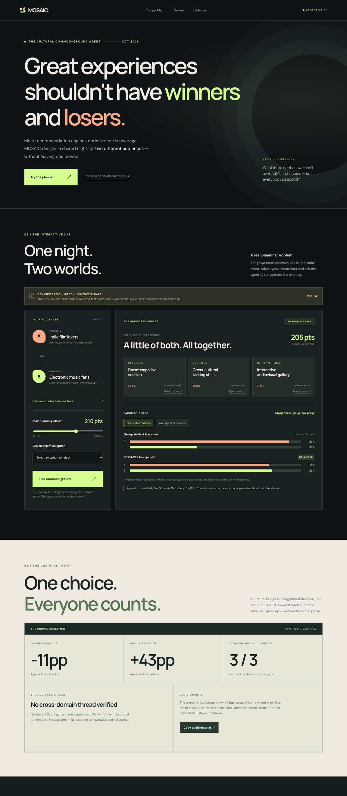

# MOSAIC — Common Ground, by Design

**A cultural negotiation agent for event promoters and community organizers.**

*One room. Two audiences. A cultural agreement that explains the trade-offs.*

[**Interactive preview — synthetic data**](https://abdullah-m7.github.io/qloo-mosaic/) · [**Hosted Node demo — synthetic data**](https://mosaic-agent-2026.onrender.com/) · [**Qloo Agentic Hackathon**](https://qloo.devpost.com/)



> **Live data status:** Qloo event API access has been requested and receipt confirmed. As of October 12, 2026, the event key has not arrived. Both demos currently show **clearly labeled synthetic preferences**; neither is presented as a validated Qloo-backed entry.

## Experimental direction: Lineup Red-Team & Rescue

A new independent feature branch is testing a sharper Qloo use case: audit a previously published music lineup and rescue it after a hypothetical cancellation with one minimum-change artist substitution. The existing sample engine and main prototype remain separate.

- Live public **synthetic-only** preview: https://abdullah-m7.github.io/qloo-mosaic/lineup/ (and /lineup.html from the local Node server).
- Pure strict-ID policy: **src/lineupAudit.mjs**; simulated rankings are clearly marked, NOT Qloo results.
- Independent read-only Codex Astra and Claude Fable assessments: **docs/REDTEAM_REVIEW.md**.
- Pre-registered real published lineups and falsification protocol: **docs/REDTEAM_PROTOCOL.md**.

The event Qloo key has not arrived. No feature here claims real Qloo ranking, artist booking availability, rights or attendance forecasts. **Do not submit this synthetic experimental branch as the final Devpost entry.**

## The challenge

An event promoter wants to bring together communities with different cultural tastes — for example, independent film fans and electronic music listeners. Choosing what the largest group prefers may alienate the other. Choosing whatever has the best average rank may still neglect one audience.

MOSAIC designs a *shared cultural activation* spanning an artist, a place and a film-themed experience. The key output is **the Cultural Bridge Agreement**: an explainable proposal showing which options provide common ground, how each community's relative rank changes compared with alternative selection policies, and what cultural connections can actually be traced to Qloo evidence.

It does **not** book venues, reserve artists, license films or predict a real audience's satisfaction.

## What the agent does

1. **Discover:** Ask Qloo for relevant entities using publicly chosen taste anchors from both groups. If joint discovery returns too little evidence, try a **single bounded alternative**, never an unbounded search.
2. **Compare:** Rank the *identical* shortlist against each group's taste anchors independently. Use **within-list ordinal percentile proxies** rather than treating scores from separate Qloo calls as directly comparable or calibrated probabilities.
3. **Negotiate:** Search feasible three-category combinations and maximize the **lower** of the two relative group rank scores. Show separate globally computed one-sided and average-first baselines, not a strawman comparator.
4. **Verify cultural threads:** When available, call Qloo's entity tag tool at most once per selected category. A shared cross-category motif is shown **only if Qloo reports the same verified tag across two different chosen categories**. Otherwise the UI explicitly states *No cross-domain thread verified*.
5. **Adapt and explain:** Reject options, change the taste anchors and inspect the tool trace. The planner reuses cached Qloo evidence for ordinary veto-based renegotiation; incomplete or ambiguous Qloo evidence causes abstention, **never a synthetic fallback disguised as Qloo**.

Unlike a conventional group recommender, the application exposes the cultural and decision-making process: whose preference shaped the result, how the compromise changes, and which cultural links are — or are not — supported.

## First-look demo

In the **synthetic preview**, choose a planning budget, inspect three candidate experiences, switch the one-sided versus mean-first comparison, veto a suggestion and watch the agreement update. Click *Copy decision brief* to capture the chosen items, evidence identifiers, quantified trade-off and limitations.

The preview's example scores, tag availability and planning tokens are invented **solely for demonstration and testing**. The live Qloo mode requires a separate server-side event credential, so the public sample is not a valid final competition entry.

## What is implemented, versus what is not

| Area | Verified status |
| --- | --- |
| Responsive interface, working veto/undo and comparison controls | Tested in desktop and mobile Chrome |
| Optimizer, provenance gates, bounded agent orchestration and cultural treaty | **50/50 local automated checks passed**; Qloo tool responses mocked in agent tests |
| Deterministic algorithmic falsification | 500 **synthetic** scenarios, 429 feasible; see below |
| Public open-source repo and externally hosted Node app | Deployed; Node app is intentionally **sample mode** |
| Qloo live API integration and real shared-tag evidence | **Pending** event-issued credential and live schema validation |
| Public, judge-ready Qloo experience and Devpost final submission | **Not completed** |

## Reproducible tests

Requires Node.js 24 (Node >=22 is supported):

```bash
git clone https://github.com/Abdullah-m7/qloo-mosaic.git
cd qloo-mosaic
npm ci
npm test
npm run benchmark
QLOO_MODE=sample npm start
```

Open http://localhost:8788. Run `npm run build:preview` to generate the static synthetic-only UI in `dist-preview/`.

The offline property experiment generates 500 deterministic score assignments (seed `20261012`). For 429 scenarios a feasible plan exists. In **all 429**, maximin's worst-group proxy was at least as high as the one-sided and mean-first alternatives — **a mathematical consequence of the optimization objective**, not proof of product quality. Average worst-group rank-proxy improvement over the one-sided alternative was 0.132, and relative to mean-first it was 0.024. An ablation on **actual Qloo-derived candidates** is still required.

## Live Qloo setup — after key approval

The app depends on Qloo's official `@qloo/qloo-harness`, using the read-only MCP tools `qloo_recommend`, `qloo_rank`, `qloo_entity_tags` and `qloo_capabilities`.

The key is a **hackathon-only secret**. Configure it in your server's secure environment as `QLOO_API_KEY`, never in a browser, public repository, example URL or screenshot. The service pins `QLOO_BASE_URL=https://hackathon.api.qloo.com` instead of the production Qloo API endpoint.

```bash
QLOO_MODE=live npm start
```

If there is no key or Qloo returns inadequate evidence, the live endpoint responds with an explicit error. It does not substitute fixture data. Before any final submission we will verify real Qloo request/response schemas, accuracy of entity resolution and ordinal ranking, limited API usage, error recovery and performance of the public live deployment.

## Repo map

- `src/engine.mjs` — optimizer and evidence gates
- `src/qloo.mjs` — bounded Qloo tools, provenance and result validation
- `src/treaty.mjs` — cross-category tag validation and decision agreements
- `server.mjs` — server-side API orchestration, short-lived evidence cache
- `public/` — responsive product experience
- `tests/` — adversarial, API, browser-independent unit and mocked tool tests
- `scripts/benchmark.mjs` and `evidence/` — reproducible **synthetic** results
- `scripts/build-static-preview.mjs` — deliberately offline preview generator
- `docs/DEPLOY.md` — live deployment and key-handling instructions
- `docs/STATUS.md` — implementation and limitations ledger

## License and acknowledgments

Original project code released under **MIT**. Qloo remains a separate third-party data provider; its data and API are subject to their own terms. No personal taste records or participant identity information is needed for the synthetic demos.

Built independently for the [Qloo Agentic Hackathon 2026](https://qloo.devpost.com/) by Abdullah Almohammedi. The submission closes **October 30, 2026 at 11:45 PM EDT**.
